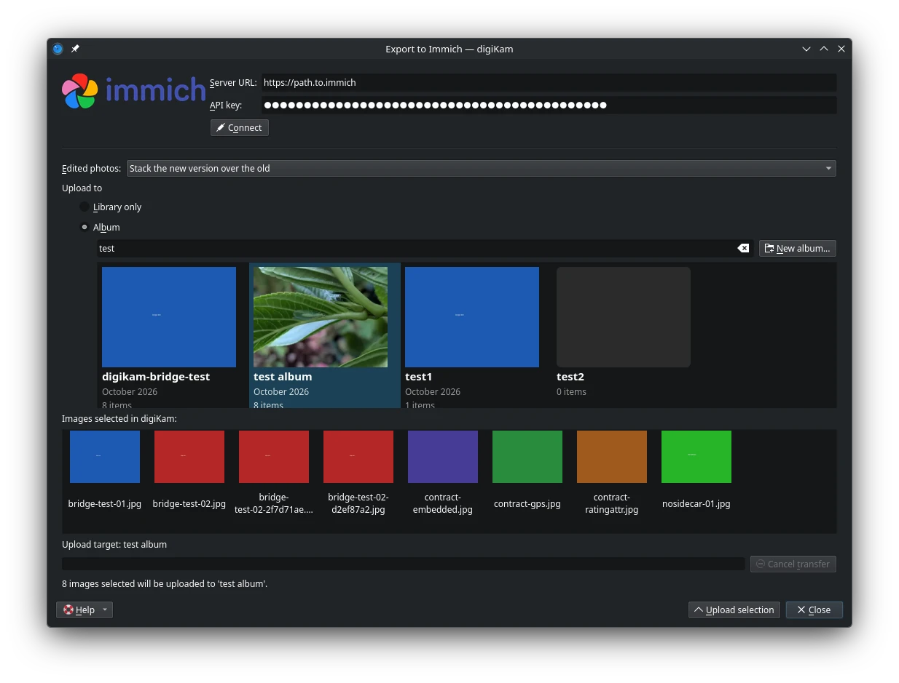
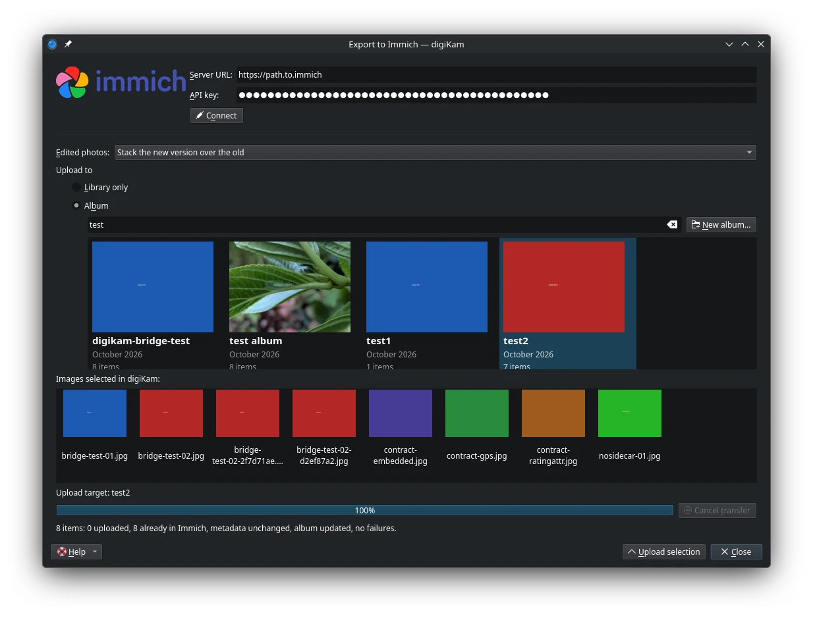

.. meta::
   :description: digiKam Export to Immich Web-Service
   :keywords: digiKam, documentation, user manual, photo management, open source, free, learn, easy, immich, export, self-hosted

.. metadata-placeholder

   :authors: - digiKam Team

   :license: see Credits and License page for details (https://docs.digikam.org/en/credits_license.html)

.. _immich_export:

:ref:`Export To Immich <export_tools>`
======================================

This tool allows the user to upload photos to an Immich server.

`Immich <https://immich.app/>`_ is an open source, self-hosted photo and video backup platform. You run the Immich server yourself, on your own hardware, and this tool connects digiKam to that server so the photos you manage and edit in digiKam can be published to it.

The plugin also provides a companion download tool, described in the :ref:`Import from Immich <immich_import>` chapter. Both tools share a single window and the same connection settings, and each opens in its own mode: this one from the :menuselection:`Export --> Export to Immich` menu entry.

Before the tool can do anything, it must connect to your server. At the top of the window, enter the **Server URL** of your Immich server and the **API key** to authenticate with, then press the **Connect** button. The tool checks the settings, stores them for the next sessions, and loads the list of albums from the server. The API key is kept in the KDE wallet when one is available. With stored settings, the tool connects automatically when it opens, and pressing **Connect** again reloads the albums, for example after albums have been created or renamed in the Immich web interface.

You create an API key in the Immich web interface, under :menuselection:`Account Settings --> API Keys`. The key needs the ``asset.upload``, ``asset.read``, ``asset.view``, ``asset.download``, ``album.read``, ``album.create``, ``albumAsset.create`` and ``tag.read`` permissions. Updating the metadata of photos already on the server additionally needs ``asset.update``, ``tag.create`` and ``tag.asset``. Stacking a replacement photo on top of its previous version needs ``stack.create`` and ``stack.read``, and sending the previous version to the trash needs ``asset.delete``.

    The Immich Export Tool Dialog

By default, the tool uploads the items currently selected in digiKam. The selected items are shown as thumbnails in the window, and the selection made in digiKam is the upload set.

With the **Upload to** options, you choose where the photos go on the server. **Library only**, the default, uploads them into the library without assigning an album. The alternative is an album, chosen from the album tiles below: the tiles are sorted by name, a filter field narrows the list, and the **New Album** button creates a new album on the server. The chosen target is remembered for the next session.

The **Edited photos** option decides what happens when a photo you upload is recognised as a new version of one the server already has, as described in the re-exporting section below. **Stack**, the default, places the new version on top of the old one as the primary of a stack. **Overwrite** sends the old version to the Immich trash instead.

    The Immich Export Uploading in Progress

Press the **Upload selection** button to transfer the items. A progress bar follows the transfer, the **Cancel** button aborts it, and when the transfer ends a line in the window summarises the outcome, with the counts of uploaded, updated and skipped items.

Re-exporting Photos
-------------------

Exporting the same selection again is safe, and never produces a duplicate on the server. The tool recognises a file as one the server already has from its file name, capture time and dimensions, confirmed by comparing its pixels with the server copy. What happens next depends on what changed since the last export:

* If nothing changed, nothing is uploaded, and only metadata differences are written, as below.

* If only the metadata changed, the pixels being identical, nothing is uploaded either. The changed tags, rating, caption and GPS position are written to the existing photo on the server through the API. Tag changes are additive: a tag removed in digiKam is not removed on the server.

* If the picture itself was edited, the new version is uploaded and added to every album the old version belonged to. With **Stack**, it becomes the primary of a stack with the old version. With **Overwrite**, the old version is moved to the Immich trash, where it can be recovered for 30 days. In both cases the replacement is a new photo on the server: links shared from the old version do not carry over, and edits made to the old version inside Immich are lost.

* If the photo was cropped or resized, so its dimensions no longer match, it is only replaced when a check confirms the local image is a crop of the server photo.

* If the evidence is ambiguous, nothing is overwritten or stacked, and the file is uploaded as a new photo.

A renamed file cannot be recognised, because recognition needs the file name and the capture time to survive the edit. Files the tool cannot decode, such as RAW files, are never replaced or stacked; their metadata still synchronises.

How Metadata Travels
--------------------

Metadata travels between digiKam and Immich in XMP sidecar files, which both applications read and write. On upload, the tool generates a sidecar from the metadata in digiKam's database, holding the tags, the rating, the caption and the GPS position, and merges it over the file's existing XMP, so properties the tool does not set, colour labels included, survive the round trip. On download, the sidecar written by Immich is stored next to each original.

Pixel edits do not travel in XMP. Only rendered exports, such as JPEG or TIFF files, carry pixel changes back to Immich.
