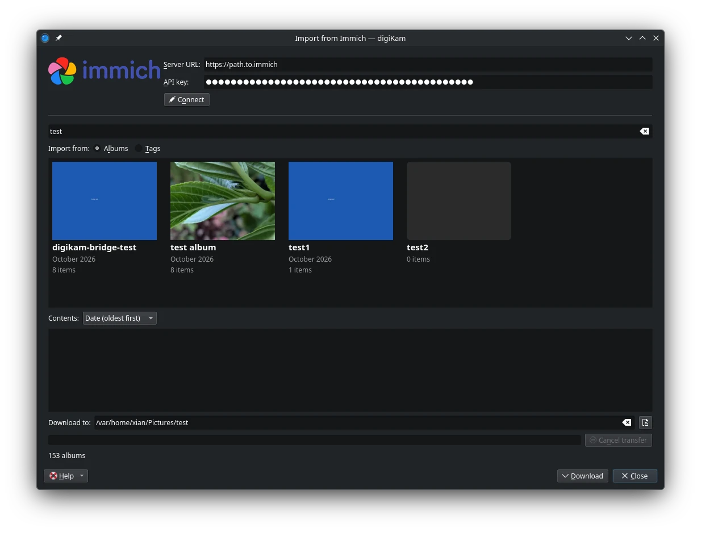

.. meta::
   :description: digiKam Import from Immich Web-Service
   :keywords: digiKam, documentation, user manual, photo management, open source, free, learn, easy, immich, import, self-hosted

.. metadata-placeholder

   :authors: - digiKam Team

   :license: see Credits and License page for details (https://docs.digikam.org/en/credits_license.html)

.. _immich_import:

:ref:`Import from Immich <import_tools>`
========================================

This tool downloads photos from an Immich server.

`Immich <https://immich.app/>`_ is an open source, self-hosted photo and video backup platform. You run the Immich server yourself, on your own hardware, and this tool connects digiKam to that server so the albums and tagged photos stored on it can be brought into digiKam.

Use the :menuselection:`Import --> Import from Immich` menu entry to access this tool. It shares a window and the connection settings with the companion upload tool described in the :ref:`Export To Immich <immich_export>` chapter: at the top of the window, enter the **Server URL** of your Immich server and an **API key**, then press the **Connect** button to load the contents of the server. The API key is created in the Immich web interface and needs the permissions listed in the export chapter. With stored settings, the tool connects automatically when it opens, and pressing **Connect** again reloads the contents.

    The Immich Import Tool Dialog

The tool presents the contents of the server as tiles: one for each album, and one for each tag, sorted by name, with a filter field to narrow the list. Selecting a tile previews its photos as thumbnails, which can be sorted before downloading.

The **Download to** field holds the local folder the photos are written to, and is remembered between sessions. Press the **Download** button to transfer the photos of the selected album or tag. A progress bar follows the transfer, the **Cancel** button aborts it, and when the transfer ends a line in the window summarises the outcome.

The photos are written as originals, each with the XMP sidecar the server provides, so the tags, rating, caption and GPS position stored in Immich arrive in digiKam with them. A file that already exists in the folder is not downloaded again, but its sidecar is refreshed, so metadata changed in Immich still reaches digiKam.
